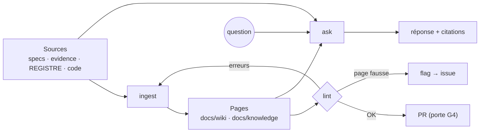

# knowledge-maintenance

Les explications sont **compilées** à partir des sources du dépôt, comme un compilateur produit un binaire à partir du code : on ne les réécrit pas de mémoire, on les régénère depuis ce qui est prouvé. Idée inspirée de la génération de wiki de WeKnora (Tencent, MIT) — réécrite, aucun texte copié (registre D-25).

## Fichiers
| Fichier | Rôle |
|---|---|
| `docs/wiki/*.md` | pages publiées sur le wiki GitHub (`scripts/publish-wiki.sh`) |
| `docs/knowledge/sources.json` | page → sources (chemin + sha256 à la dernière curation) |
| `scripts/knowledge-lint.mjs` | contrôle déterministe (voir `references/lint-rules.md`) |
| `tests/knowledge/golden-qa.json` + `scripts/knowledge-eval.mjs` | questions de référence pour mesurer le mode `ask` |

## Mode `ingest` — mettre les pages à jour
1. Trouver les pages concernées : `node scripts/knowledge-lint.mjs` → avertissements `stale-page` (source modifiée) ; ou `git diff --name-only <base>...HEAD` croisé avec `docs/knowledge/sources.json`.
2. Pour chaque page : relire **les sources déclarées** (pas la page seule), puis appliquer `references/page-rules.md`.
3. Nouvelle page : l'ajouter à `docs/knowledge/sources.json`, la lier depuis `Home.md` et `_Sidebar.md` (sinon `orphan-page`).
4. `node scripts/knowledge-lint.mjs --update-sources` puis `node scripts/knowledge-lint.mjs` → **0 erreur** exigé.
5. Résumer dans la PR : pages touchées, sources lues, contradictions trouvées, propositions de registre (non appliquées).

## Mode `lint` — santé
`node scripts/knowledge-lint.mjs [--json]`. Erreurs (`E`) bloquantes, avertissements (`W`) à traiter ou justifier. Score de santé = 100 − 10 × erreurs − 2 × avertissements.

## Mode `ask` — répondre
Protocole `references/ask-protocol.md` : recherche d'abord (`Grep`/`Glob` sur `specs/`, `docs/`, `evidence/`, `.claude/`, `factory/`), réponse **uniquement** à partir de ce qui a été lu, chaque affirmation suivie de sa citation ; si rien n'est trouvé : « pas de source dans le dépôt ». Distinguer **fait** (F, preuve P, code), **hypothèse** (H) et **décision** (D).

## Mode `flag` — signaler
Page fausse ou contradiction non résoluble : ouvrir une issue avec le label `documentation`, titre `[knowledge] <page> : <problème>`, corps = extrait de la page + source contradictoire (citations). Ne pas corriger une page dont la vérité dépend d'une décision humaine (porte G1/G3).

## Mesure
`node scripts/knowledge-eval.mjs` rejoue `tests/knowledge/golden-qa.json` : pour chaque question, vérifie que les fichiers attendus contiennent bien les termes attendus (la connaissance existe et est trouvable). Score = proportion de questions couvertes. À relancer après chaque `ingest`.
