# TELA Agentic Factory (ERC-20 bridge)

Reproduction de l'infrastructure **TELA** (Talan) par une *agentic factory* Claude Code : 9 agents spécialisés, travail en **Spec-Driven Development** (GitHub Spec Kit 1.3.2), **preuve d'exécution** exigée pour chaque tâche, sécurité par défaut (skill Cloudflare `security-audit`).

| | |
|---|---|
| **Chaîne d'écriture** | Angular → Java (Spring Boot) → Kafka → Adaptateur TS/viem → Web3Signer → Besu (QBFT) |
| **Chaîne de lecture** | Besu → Ponder → PostgreSQL → Java → Angular |
| **Actifs** | TCE · TCD · TIF · TalanFixedRateSwap (1 TCE = 1,15 TCD, taux immuable) |
| **État** | Transfert TCE de bout en bout **validé** (spec 002 : SC-001…SC-004) · UI opérateur livrée · portage vers l'infra Talan en cours (spec 008) |

> 📘 Wiki : documentation détaillée synchronisée depuis [`docs/wiki/`](docs/wiki/Home.md).
> 🧑‍⚖️ Où un humain doit valider : [Validations humaines](docs/wiki/Validations-humaines.md) · registre machine [`factory/human-gates.yaml`](factory/human-gates.yaml) · `scripts/human-gates.sh`.

---

## Sommaire
1. [Architecture (UML)](#1-architecture-uml)
2. [Cycle de vie d'une opération](#2-cycle-de-vie-dune-opération)
3. [Garanties d'effet unique](#3-garanties-deffet-unique)
4. [La factory agentique](#4-la-factory-agentique)
5. [Validations humaines](#5-validations-humaines)
6. [Résultats de validation (graphes)](#6-résultats-de-validation-graphes)
7. [Feuille de route Talan](#7-feuille-de-route--passer-sur-linfra-talan-spec-008)
8. [Réutiliser la factory (kit)](#8-réutiliser-la-factory-sur-un-dépôt-talan-factory-kit)
9. [Démarrage rapide](#9-démarrage-rapide)
10. [Tester à la main](#10-tester-à-la-main)
11. [Specs, preuves et état](#11-specs-preuves-et-état)
12. [Arborescence](#12-arborescence)
13. [Documents clés](#13-documents-clés)

---

## 1. Architecture (UML)

### Diagramme de composants
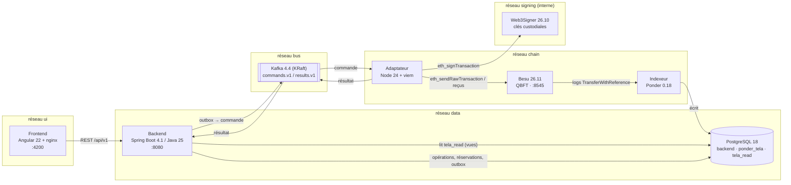

> **Comment lire.** Chaque cadre est un réseau Docker isolé ; un service n'atteint que les réseaux dont il est membre. Le **chemin d'écriture** va de gauche à droite (UI → Java → Kafka → adaptateur → Web3Signer → Besu) ; le **chemin de lecture** revient par Ponder et PostgreSQL. Deux points clés : seul l'adaptateur parle à Web3Signer (réseau `signing` interne, aucune clé ne sort du signeur), et Java ne lit jamais la chaîne directement : il lit les vues `tela_read` alimentées par l'indexeur.

### Diagramme de déploiement (sandbox Docker Compose)
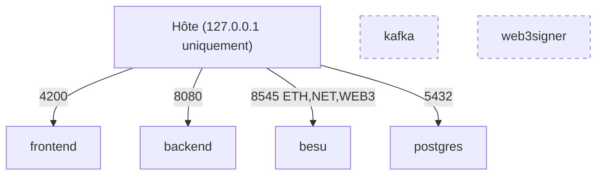

> **Comment lire.** Les flèches pleines sont les seuls ports publiés, et uniquement sur `127.0.0.1` : rien n'est exposé sur le réseau local. Les cadres pointillés (Kafka, Web3Signer) n'ont **aucun** port publié ; `scripts/sandbox.sh check` vérifie ces propriétés à chaque démarrage.
Kafka et Web3Signer ne sont **pas publiés** sur l'hôte. Web3Signer n'est joignable que par le réseau interne `signing`.

### Modèle de domaine (classes)
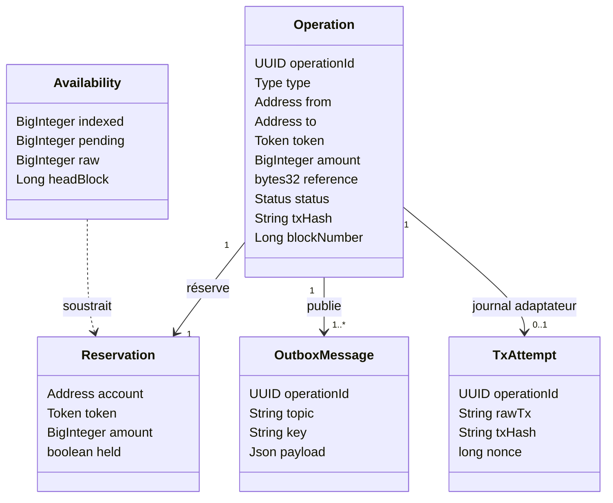

> **Comment lire.** Une `Operation` porte une `reference` déterministe (`keccak256(operationId)`) qui sert de clé d'idempotence **sur la chaîne**. Elle crée une `Reservation` (montant bloqué dès l'acceptation), un `OutboxMessage` (écrit dans la même transaction SQL, donc jamais perdu) et, côté adaptateur, un `TxAttempt` journalisé **avant** diffusion. `Availability` est ce que renvoie l'API : `raw = indexé − réservations pas encore indexées`.

## 2. Cycle de vie d'une opération

### Séquence d'un transfert
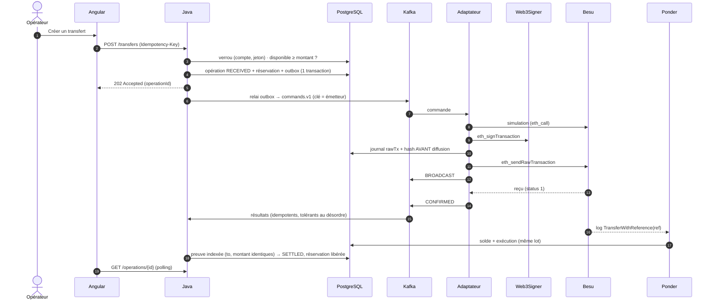

> **Comment lire.** Étapes 1–5 : synchrones, la réponse `202` arrive avant toute interaction blockchain. Étapes 6–14 : asynchrones via Kafka. L'étape critique est la **10** : la transaction signée est journalisée *avant* d'être envoyée ; après un crash, l'adaptateur rediffuse exactement la même transaction (même hash) au lieu d'en signer une nouvelle. Étapes 15–17 : le règlement `SETTLED` ne dépend pas des messages Kafka mais de la **preuve indexée** (D-14).
>
> Mesure en direct (sandbox, 2026-11-09, transfert de 2,5 TCE, non archivée comme preuve) : `PUBLISHED` +23 ms · `BROADCAST` +193 ms · `CONFIRMED` +1,7 s · `SETTLED` +2,2 s.

### Diagramme d'états
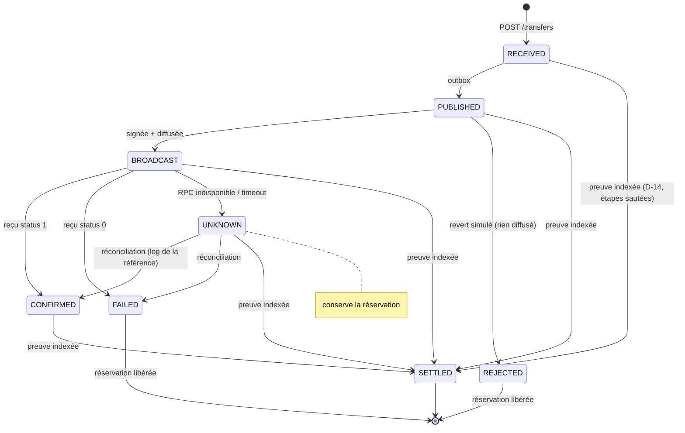

> **Comment lire.** Chemin nominal : de `RECEIVED` à `SETTLED`. Les deux terminaux d'échec **libèrent** la réservation car l'issue est certaine : `REJECTED` (simulation échouée, rien diffusé) et `FAILED` (minée avec statut 0). `UNKNOWN` est différent : la transaction a peut-être été exécutée (RPC coupé, timeout), donc la réservation est **conservée** jusqu'à ce que la réconciliation trouve le log de la référence. Les flèches directes vers `SETTLED` traduisent D-14 : si l'indexeur voit l'exécution avant que Kafka n'apporte les résultats, l'opération est réglée sans attendre.

## 3. Garanties d'effet unique

| Couche | Mécanisme | Preuve |
|---|---|---|
| HTTP | `Idempotency-Key` : même clé → même opération ; corps différent → 409 | tests backend |
| Base | réservation sous verrou ; `disponible = indexé − réservations non encore indexées`, lu dans **un seul snapshot SQL** (D-21) | SC-004 : 1000 requêtes, min brut = 0 |
| Kafka → adaptateur | journal `tx_attempt` écrit **avant** diffusion ; jamais deux signatures pour un `operationId` | SC-002 : 119 crashs réels, 0 double débit |
| Chaîne | `transferWithReference` : référence `keccak256(operationId)` consommable **une fois par émetteur** | spec 001 : rejeu → `ReferenceAlreadyUsed` |
| Lecture | `SETTLED` seulement sur événement indexé identique ; garde de watermark contre le retour en arrière de Ponder (D-23) | tests de régression |

## 4. La factory agentique

### Agents et périmètres
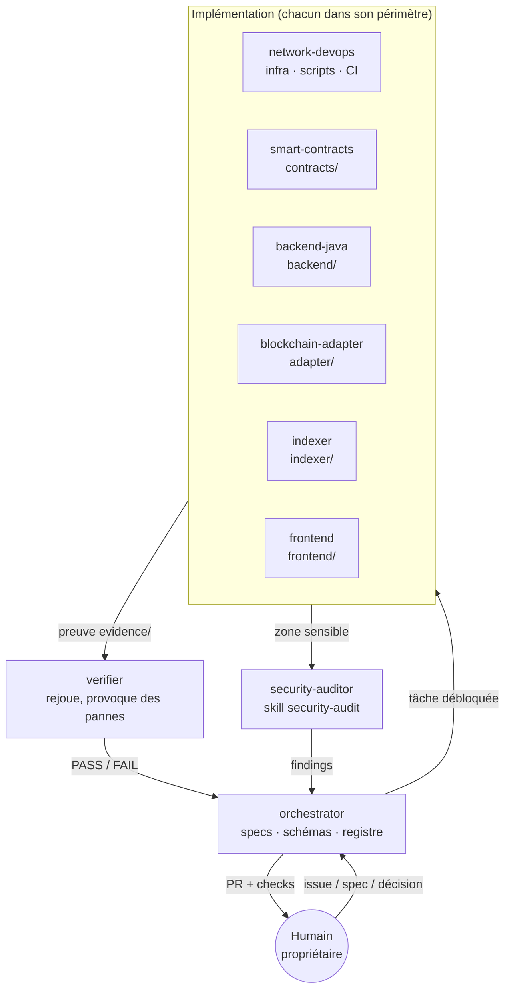

> **Comment lire.** L'humain entre et sort par l'orchestrateur : il donne une issue/spec, il reçoit une PR. L'orchestrateur ne code pas ; il découpe et attribue. Chaque spécialiste n'écrit que dans son dossier et doit produire une preuve dans `evidence/`. Le `verifier` est **indépendant** : il rejoue la preuve et peut renvoyer FAIL. Le `security-auditor` intervient sur les zones sensibles (contrats, signature, auth, infra).

### Cycle `/factory-run NNN` (activité)
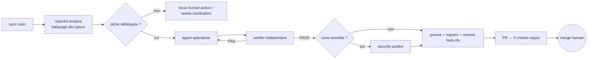

> **Comment lire.** La boucle `verifier → FAIL → spécialiste` est la seule boucle automatique ; tout le reste avance vers une **porte humaine** (cercle). Si aucune tâche n'est débloquée, la factory ne devine pas : elle ouvre une issue `human-action` ou `needs-clarification` (voir §5).

### Composants
| Élément | Rôle |
|---|---|
| `.claude/agents/*.md` | 10 agents (knowledge-curator, orchestrator, network-devops, smart-contracts, backend-java, blockchain-adapter, indexer, frontend, verifier, security-auditor) |
| `.claude/skills/` | Spec Kit (`speckit-*`), `security-audit` (Cloudflare, vendorisé), `smart-contract-security`, `factory-run` |
| `knowledge-curator` + skill `knowledge-maintenance` | tient les explications à jour depuis les sources, répond avec citations ; contrôle `scripts/knowledge-lint.mjs` (wiki *Base-de-connaissances*) |
| `.claude/hooks/guard.mjs` | Garde-fou PreToolUse v2 : profil de cible `FACTORY_TARGET` (`factory/targets/`), risque lecture / écriture / destructif → autorisé / validation humaine / refusé ; 157 cas testés dont les 22 contournements de l'audit 008 — défense en profondeur, **pas** une frontière |
| `.claude/hooks/perimeter-guard.mjs` | périmètre d'écriture de chaque agent **imposé** (`factory/perimeters.json`), déclaré dans le frontmatter des agents |
| `.specify/memory/constitution.md` | Règles non négociables : preuves, hypothèses visibles, contrats d'abord, effet unique, sécurité |
| `docs/registry/REGISTRE.md` | Faits / Hypothèses / Décisions / Preuves (F/H/D/P) |

## 5. Validations humaines

La factory avance seule **jusqu'aux portes** ci-dessous. Détail, preuves et commandes : [docs/wiki/Validations-humaines.md](docs/wiki/Validations-humaines.md). Registre lisible par les outils : [`factory/human-gates.yaml`](factory/human-gates.yaml). État courant : `scripts/human-gates.sh` (ou `--json`).

### Où l'humain intervient dans le cycle
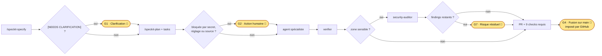
> **Comment lire.** Les pastilles jaunes sont les moments où la factory **s'arrête** et attend le propriétaire. Une seule (G4) est imposée par le serveur GitHub : sans PR et sans les 9 checks verts, rien n'entre dans `main`. G1, G2 et G7 sont des conventions tracées par labels et issues ; elles apparaissent sur le tableau GitHub et dans `scripts/human-gates.sh`.

### Portes transverses
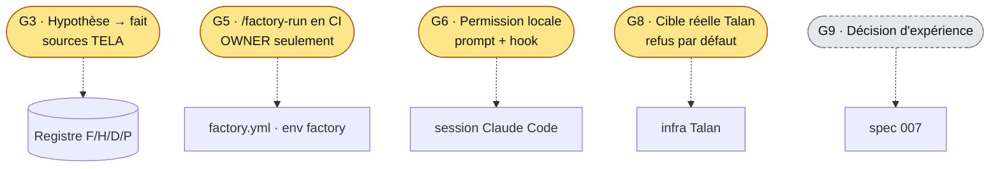
> **Comment lire.** Ces portes ne sont pas liées à une étape du cycle mais à un type d'action. G8 est appliquée par le hook `guard.mjs` v2 : avec un profil réel, les actions destructives sont refusées et les écritures d'infrastructure ou diffusions hors liste demandent une validation humaine. En gris pointillé : **prévue, pas encore appliquée** : G9 (gouvernance des expériences, #24).

### Tableau récapitulatif
| Porte | Quand | Qui | Appliquée par |
|---|---|---|---|
| G1 Clarification | spec avec `[NEEDS CLARIFICATION]` | propriétaire | convention + label `needs-clarification` |
| G2 Action humaine | secret, réglage, source externe | propriétaire | label `human-action` |
| G3 Hypothèse → fait | toute H du registre | propriétaire (sources TELA) | constitution |
| G4 Fusion sur `main` | toute PR | propriétaire | **serveur** : PR + 9 checks, admins inclus |
| G5 Lancement factory CI | `/factory-run` en commentaire | OWNER uniquement | **serveur** : environnement `factory` limité à `main` |
| G6 Permissions locales | commande hors allowlist | utilisateur Claude Code | Claude Code + hook |
| G7 Risque résiduel sécurité | findings non corrigés | propriétaire | issues de suivi |
| G8 Cible réelle (Talan) | tout endpoint non-sandbox | propriétaire | **hook** `guard.mjs` v2 + profils `factory/targets/` (D-26) |

## 6. Résultats de validation (graphes)

Spec 002, tous critères mesurés sur le **même commit `7d4a02d`** (images reconstruites depuis ce SHA). Preuves : `evidence/002/campaign-sc00*/runs/<RUN_ID>/evidence.json` · matrice : [`validation-matrix.md`](specs/002-tce-transfer-e2e/validation-matrix.md).

### SC-003 — Latence demande → confirmation (60 opérations, 1 req / 3 s)
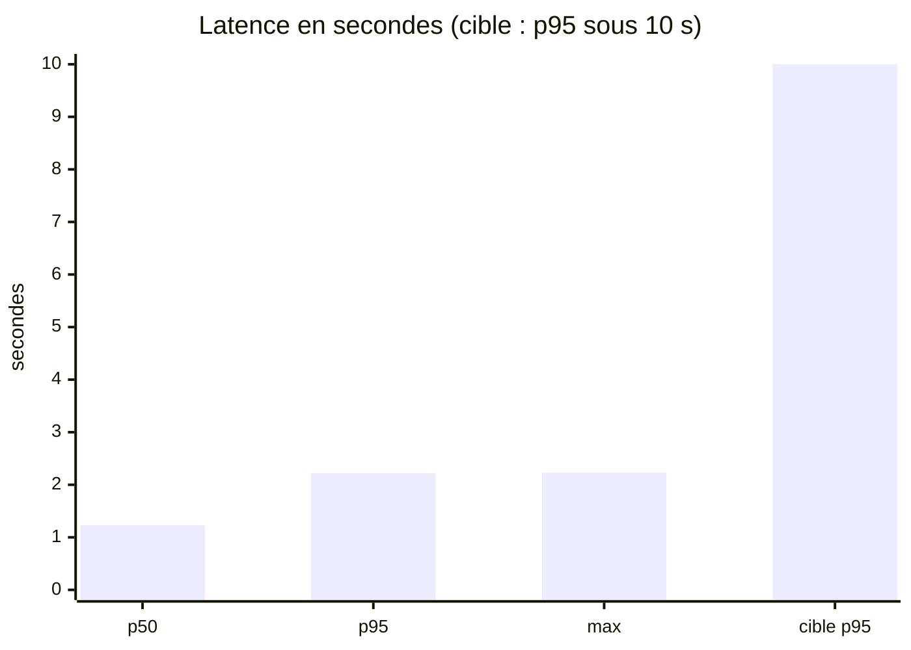
> **Lecture.** Avec des blocs de 2 s, une opération est confirmée en ~1 bloc : p95 = 2,22 s, soit 4,5× sous la cible. La charge est volontairement espacée (1 requête / 3 s) : c'est une mesure de **latence**, pas de débit. Le débit de l'adaptateur (≈ 1 tx par bloc, traitement sériel) est un sujet séparé (#26).

### SC-002 — Crashs réels aléatoires de l'adaptateur
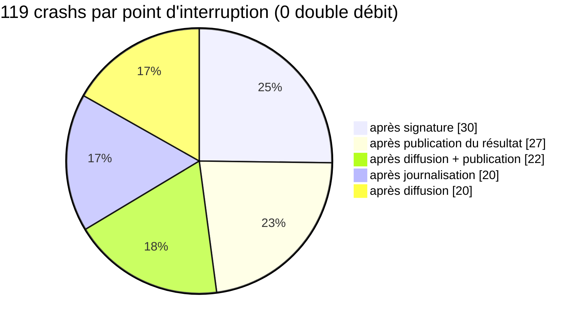
> **Lecture.** Le processus est tué **réellement** à 5 points différents entre la signature et la publication du résultat, là où un double débit serait possible. Sur 120 opérations : 120 réglées, 120 événements on-chain, débit on-chain = débit attendu (120 TCE). Le journal écrit avant diffusion et la référence on-chain rendent chaque reprise idempotente.

### SC-004 — 1 000 demandes simultanées pour 100 places
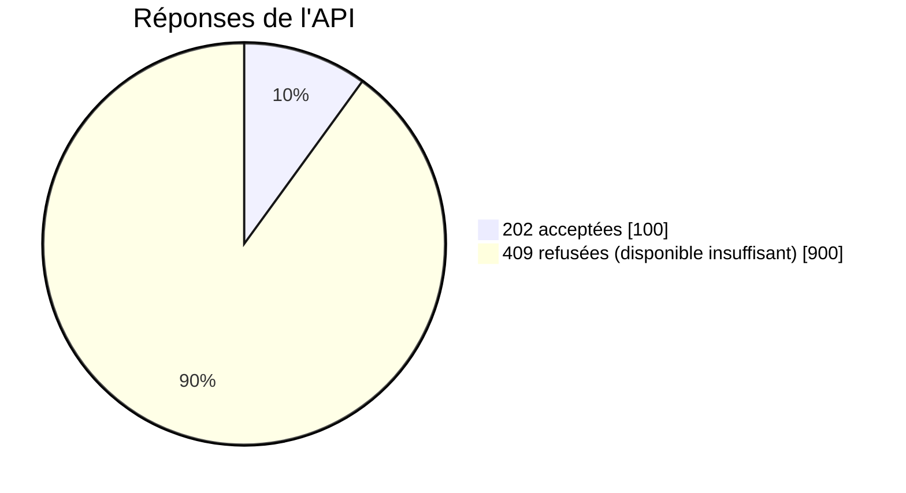
| Mesure (103 instantanés pendant l'exécution) | Minimum observé |
|---|---|
| Disponible **brut** de l'API (`indexé − réservations non indexées`, snapshot SQL unique, D-21) | **0** ✅ jamais négatif |
| Formule naïve `indexé − total réservé` (pour comparaison) | **−1 000 000** ❌ |

> **Lecture.** Le compte avait exactement 100 × le montant : l'API en accepte exactement 100, refuse les 900 autres, et le disponible ne passe jamais sous zéro. La ligne « naïve » montre pourquoi la décision D-21 était nécessaire : une opération déjà indexée **et** encore réservée serait comptée deux fois.

### SC-001 — Répétabilité
40/40 : les 4 scénarios exigés (nominal, redémarrage après émission, retard de Ponder, échec certain vs inconnu) rejoués 10 fois de suite sans échec.

## 7. Feuille de route : passer sur l'infra Talan (spec 008)
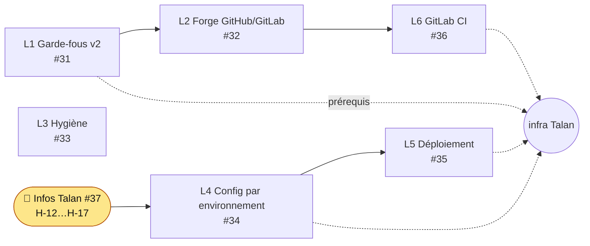
> **Lecture.** L1 (garde-fous) est le prérequis absolu : l'audit a montré 22 commandes dangereuses sur une infra réelle que le hook actuel laisse passer. L3 est indépendant et peut avancer en parallèle. L4 et L5 attendent les réponses Talan (#37) : chaîne, finalité, gas, key store, cible de déploiement. Détail : wiki *Talan-Readiness*.

## 8. Réutiliser la factory sur un dépôt Talan (factory kit)

La factory est séparée en **modules** décrits dans [`factory/kit/manifest.json`](factory/kit/manifest.json). La commande `scripts/factory-kit.sh` les extrait de ce dépôt et les installe dans n'importe quel autre dépôt (GitLab Talan, autre projet), avec un fichier de verrou pour suivre les mises à jour.

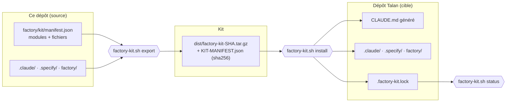

| Module | Contenu | Portable aujourd'hui ? |
|---|---|---|
| `core` | Spec Kit (`.specify/`, skills `speckit-*`), orchestrator, verifier, security-auditor, skill `security-audit` (Cloudflare), hook `guard.mjs` + tests, portes humaines, `factory-run` | ✅ oui en local ; ⚠️ pas pour agir sur une infra réelle avant #31 (G8), `gh` codé en dur avant #32 |
| `blockchain` | agents smart-contracts, blockchain-adapter, indexer ; skill `smart-contract-security` | ✅ oui (contenu orienté EVM/Besu/Web3Signer) |
| `stack-tela` | agents backend-java, frontend, network-devops | ⚠️ contiennent les chemins de ce monorepo : à relire |
| `knowledge` | agent knowledge-curator + son hook de périmètre, skill knowledge-maintenance, scripts `knowledge-lint` / `knowledge-eval` | ✅ oui (déclarer ses pages dans `docs/knowledge/sources.json`) |
| `governance` | constitution TELA, modèle de registre F/H/D/P | ✅ comme point de départ |

```bash
scripts/factory-kit.sh list                                    # modules et fichiers
scripts/factory-kit.sh export --modules core,blockchain        # → dist/factory-kit-<sha>.tar.gz
scripts/factory-kit.sh install ../talan-repo --modules core,blockchain --project "TELA Talan" --dry-run
scripts/factory-kit.sh install ../talan-repo --modules core,blockchain --project "TELA Talan"
scripts/factory-kit.sh status ../talan-repo                    # fichiers modifiés localement / en retard sur la source
```
Règles du kit : **jamais** de fichier existant écrasé sans `--force` ; aucun secret, `.env`, preuve ou code applicatif n'est copié ; chaque fichier est listé avec son sha256 dans `.factory-kit.lock`. Une fois installé dans le dépôt cible, lancer Claude Code dans ce dépôt et commencer par `/speckit-constitution` puis `/speckit-specify`.

## 9. Démarrage rapide
Prérequis : Docker, bash (Git Bash sous Windows), openssl, node, python. Aucun outil blockchain local requis (Foundry/Maven en conteneurs), aucun secret à saisir.

```bash
scripts/bootstrap-env.sh                           # une fois : clés Web3Signer, mots de passe, genèse QBFT → .env + infra/.secrets (gitignored)
scripts/sandbox.sh up                              # Besu, Web3Signer, PostgreSQL, Kafka + contrôles de sécurité
scripts/deploy-contracts.sh                        # TCE/TCD/TIF/Swap signés via Web3Signer
docker compose --profile app up -d --build --wait  # indexer, backend, adapter, frontend
scripts/sandbox.sh check                           # vérifie tout
```
| Service | URL |
|---|---|
| UI opérateur | http://localhost:4200 |
| API | http://localhost:8080/api/v1 |
| RPC Besu (lecture) | http://localhost:8545 — chainId `48151` |

## 10. Tester à la main
Seuls **Alice** et **Bob** peuvent être émetteurs (l'adaptateur ne signe que pour eux). Montants en unités minimales, 6 décimales (`1000000` = 1 TCE).

| Compte | Adresse |
|---|---|
| Alice | `0xc6ee2772bd4d6182cdb8269e307215cd54fb6765` |
| Bob | `0x1b3f4f61019c148a859808ea24434764c48a072c` |
| Treasury | `0xf618d1c914f441593193647339ec4b59381d54d9` |

Adresses générées par `bootstrap-env.sh` : elles changent si l'environnement est régénéré (`--force`).

```bash
curl -H 'content-type: application/json' -H "Idempotency-Key: test-$(date +%s)" \
  -d '{"from":"0xc6ee2772bd4d6182cdb8269e307215cd54fb6765","to":"0x1b3f4f61019c148a859808ea24434764c48a072c","token":"TCE","amount":"1000000"}' \
  http://localhost:8080/api/v1/transfers
curl http://localhost:8080/api/v1/operations/<id>/transitions
curl http://localhost:8080/api/v1/accounts/<adresse>/balances
curl http://localhost:8080/api/v1/system/indexer-status
```

## 11. Specs, preuves et état

| Spec | Sujet | Statut | Liens |
|---|---|---|---|
| 000 | Agentic factory | ✅ livrée | `specs/000-agentic-factory` |
| 001 | Sandbox + jetons | ✅ fusionnée | #16 |
| 002 | Transfert TCE E2E + incidents | ✅ validée (SC-001 40/40, SC-002 119 crashs / 0 double débit, SC-003 p95 2,22 s, SC-004 1000 requêtes) | #18, #25, `specs/002-tce-transfer-e2e/validation-matrix.md` |
| 003 | Swap TCE→TCD | 🟡 décisions prises (D-18…D-20), à planifier | #9 |
| 004 | Opérations TIF | ⛔ bloquée (sources TELA, #13) | #10 |
| 005 | UI opérateur Angular | ✅ fusionnée, audit axe en suivi | #28, #29 |
| 006 | Authentification API | 📌 réservée | #12 |
| 007 | Gouvernance des expériences | 🔎 en revue | #24 |
| 008 | Talan readiness (portage infra réelle) | 🚧 audit fait, L1 garde-fous livré (en revue), L2–L6 à faire | #38, #31–#37 |

Scénarios rejouables : `tests/e2e/run.sh <001-contracts|nominal|restart-after-broadcast|ponder-lag|failure-vs-unknown>` ; campagnes `tests/e2e/campaigns/sc00{1..4}-*.sh`. Chaque exécution écrit `evidence/<spec>/<scénario>/runs/<RUN_ID>/run.json` (SHA, config, digests d'images).

## 12. Arborescence
| Dossier | Contenu | Agent |
|---|---|---|
| `.claude/` | agents, skills, hooks, settings | orchestrator |
| `.specify/` | constitution, templates Spec Kit | orchestrator |
| `factory/` | registres lisibles par les outils (portes humaines…) | orchestrator |
| `specs/` | specs 000–008 + `ANALYSIS.md` (balayage croisé) | orchestrator |
| `schemas/` | OpenAPI, JSON Schema Kafka | orchestrator |
| `infra/`, `compose.yaml`, `scripts/` | sandbox Docker | network-devops |
| `contracts/` | Solidity / Foundry, OpenZeppelin 5.6.1 | smart-contracts |
| `backend/` | Java 25 / Spring Boot 4.1 | backend-java |
| `adapter/` | Node 24 / viem | blockchain-adapter |
| `indexer/` | Ponder 0.18 | indexer |
| `frontend/` | Angular 22 | frontend |
| `tests/e2e/`, `evidence/` | scénarios, campagnes, preuves | verifier |
| `docs/` | veille, registre, audit, wiki, actions humaines | orchestrator |

## 13. Documents clés
- [Constitution](.specify/memory/constitution.md) · [Registre F/H/D/P](docs/registry/REGISTRE.md) · [Veille & versions](docs/research/veille-2026-11.md)
- [Balayage des specs](specs/ANALYSIS.md) · [Audit Talan readiness](docs/audit/2026-11-09-talan-readiness.md) (branche `008-talan-readiness`)
- [Validations humaines](docs/wiki/Validations-humaines.md) · [Actions humaines](docs/HUMAN-ACTIONS.md) · [Wiki](docs/wiki/Home.md)
