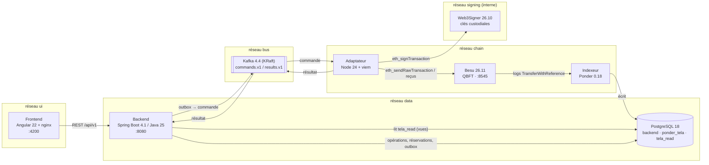
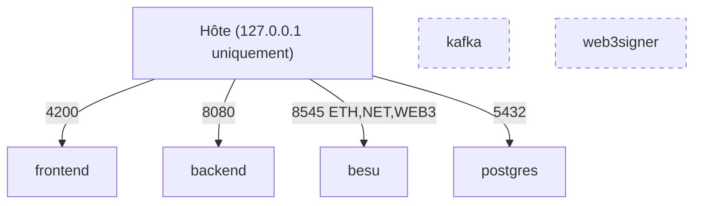
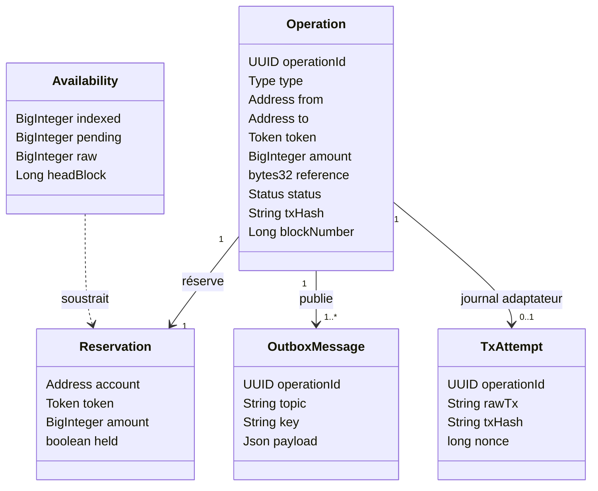
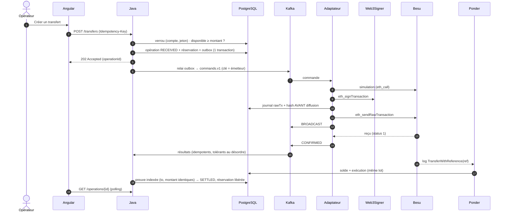
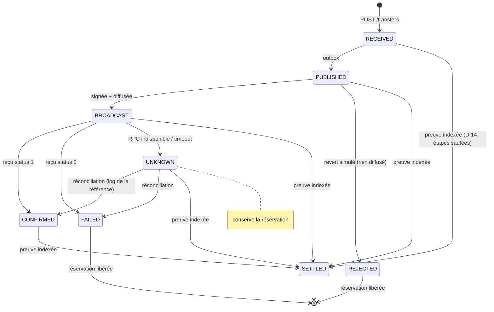
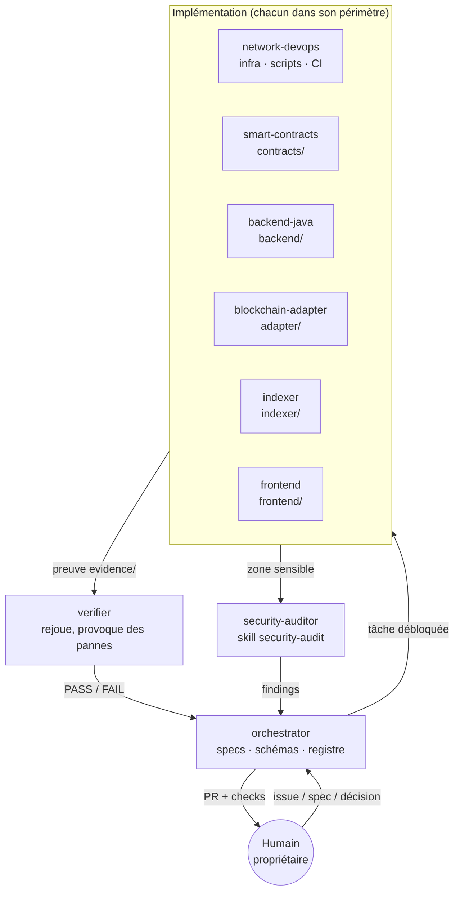
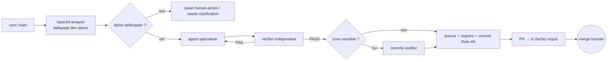

# TELA Agentic Factory (ERC-20 bridge)

Reproduction de l'infrastructure **TELA** (Talan) par une *agentic factory* Claude Code : 9 agents spécialisés, travail en **Spec-Driven Development** (GitHub Spec Kit 1.3.2), **preuve d'exécution** exigée pour chaque tâche, sécurité par défaut (skill Cloudflare `security-audit`).

| | |
|---|---|
| **Chaîne d'écriture** | Angular → Java (Spring Boot) → Kafka → Adaptateur TS/viem → Web3Signer → Besu (QBFT) |
| **Chaîne de lecture** | Besu → Ponder → PostgreSQL → Java → Angular |
| **Actifs** | TCE · TCD · TIF · TalanFixedRateSwap (1 TCE = 1,15 TCD, taux immuable) |
| **État** | Transfert TCE de bout en bout **validé** (spec 002 : SC-001…SC-004) · UI opérateur livrée · portage vers l'infra Talan en cours (spec 008) |

> 📘 Wiki : documentation détaillée synchronisée depuis [`docs/wiki/`](docs/wiki/Home.md).
> 🧑‍⚖️ Où un humain doit valider : [Validations humaines](docs/wiki/Validations-humaines.md) · registre machine [`factory/human-gates.yaml`](factory/human-gates.yaml) · `scripts/human-gates.sh`.

---

## Sommaire
1. [Architecture (UML)](#1-architecture-uml)
2. [Cycle de vie d'une opération](#2-cycle-de-vie-dune-opération)
3. [Garanties d'effet unique](#3-garanties-deffet-unique)
4. [La factory agentique](#4-la-factory-agentique)
5. [Validations humaines](#5-validations-humaines)
6. [Démarrage rapide](#6-démarrage-rapide)
7. [Tester à la main](#7-tester-à-la-main)
8. [Specs, preuves et état](#8-specs-preuves-et-état)
9. [Arborescence](#9-arborescence)
10. [Documents clés](#10-documents-clés)

---

## 1. Architecture (UML)

### Diagramme de composants


### Diagramme de déploiement (sandbox Docker Compose)

Kafka et Web3Signer ne sont **pas publiés** sur l'hôte. Web3Signer n'est joignable que par le réseau interne `signing`.

### Modèle de domaine (classes)


## 2. Cycle de vie d'une opération

### Séquence d'un transfert


### Diagramme d'états


## 3. Garanties d'effet unique

| Couche | Mécanisme | Preuve |
|---|---|---|
| HTTP | `Idempotency-Key` : même clé → même opération ; corps différent → 409 | tests backend |
| Base | réservation sous verrou ; `disponible = indexé − réservations non encore indexées`, lu dans **un seul snapshot SQL** (D-21) | SC-004 : 1000 requêtes, min brut = 0 |
| Kafka → adaptateur | journal `tx_attempt` écrit **avant** diffusion ; jamais deux signatures pour un `operationId` | SC-002 : 119 crashs réels, 0 double débit |
| Chaîne | `transferWithReference` : référence `keccak256(operationId)` consommable **une fois par émetteur** | spec 001 : rejeu → `ReferenceAlreadyUsed` |
| Lecture | `SETTLED` seulement sur événement indexé identique ; garde de watermark contre le retour en arrière de Ponder (D-23) | tests de régression |

## 4. La factory agentique

### Agents et périmètres


### Cycle `/factory-run NNN` (activité)


### Composants
| Élément | Rôle |
|---|---|
| `.claude/agents/*.md` | 9 agents (orchestrator, network-devops, smart-contracts, backend-java, blockchain-adapter, indexer, frontend, verifier, security-auditor) |
| `.claude/skills/` | Spec Kit (`speckit-*`), `security-audit` (Cloudflare, vendorisé), `smart-contract-security`, `factory-run` |
| `.claude/hooks/guard.mjs` | Garde-fou PreToolUse (secrets, force-push, protection de branche…) — défense en profondeur, **pas** une frontière ; durcissement prévu en spec 008 (#31) |
| `.specify/memory/constitution.md` | Règles non négociables : preuves, hypothèses visibles, contrats d'abord, effet unique, sécurité |
| `docs/registry/REGISTRE.md` | Faits / Hypothèses / Décisions / Preuves (F/H/D/P) |

## 5. Validations humaines

La factory avance seule **jusqu'aux portes** ci-dessous. Détail, preuves et commandes : [docs/wiki/Validations-humaines.md](docs/wiki/Validations-humaines.md). Registre lisible par les outils : [`factory/human-gates.yaml`](factory/human-gates.yaml). État courant : `scripts/human-gates.sh` (ou `--json`).

| Porte | Quand | Qui | Appliquée par |
|---|---|---|---|
| G1 Clarification | spec avec `[NEEDS CLARIFICATION]` | propriétaire | convention + label `needs-clarification` |
| G2 Action humaine | secret, réglage, source externe | propriétaire | label `human-action` |
| G3 Hypothèse → fait | toute H du registre | propriétaire (sources TELA) | constitution |
| G4 Fusion sur `main` | toute PR | propriétaire | **serveur** : PR + 9 checks, admins inclus |
| G5 Lancement factory CI | `/factory-run` en commentaire | OWNER uniquement | **serveur** : environnement `factory` limité à `main` |
| G6 Permissions locales | commande hors allowlist | utilisateur Claude Code | Claude Code + hook |
| G7 Risque résiduel sécurité | findings non corrigés | propriétaire | issues de suivi |
| G8 Cible réelle (Talan) | tout endpoint non-sandbox | propriétaire | spec 008 L1 (#31) — **pas encore appliquée** |

## 6. Démarrage rapide
Prérequis : Docker, bash (Git Bash sous Windows), openssl, node, python. Aucun outil blockchain local requis (Foundry/Maven en conteneurs), aucun secret à saisir.

```bash
scripts/bootstrap-env.sh                           # une fois : clés Web3Signer, mots de passe, genèse QBFT → .env + infra/.secrets (gitignored)
scripts/sandbox.sh up                              # Besu, Web3Signer, PostgreSQL, Kafka + contrôles de sécurité
scripts/deploy-contracts.sh                        # TCE/TCD/TIF/Swap signés via Web3Signer
docker compose --profile app up -d --build --wait  # indexer, backend, adapter, frontend
scripts/sandbox.sh check                           # vérifie tout
```
| Service | URL |
|---|---|
| UI opérateur | http://localhost:4200 |
| API | http://localhost:8080/api/v1 |
| RPC Besu (lecture) | http://localhost:8545 — chainId `48151` |

## 7. Tester à la main
Seuls **Alice** et **Bob** peuvent être émetteurs (l'adaptateur ne signe que pour eux). Montants en unités minimales, 6 décimales (`1000000` = 1 TCE).

| Compte | Adresse |
|---|---|
| Alice | `0xc6ee2772bd4d6182cdb8269e307215cd54fb6765` |
| Bob | `0x1b3f4f61019c148a859808ea24434764c48a072c` |
| Treasury | `0xf618d1c914f441593193647339ec4b59381d54d9` |

Adresses générées par `bootstrap-env.sh` : elles changent si l'environnement est régénéré (`--force`).

```bash
curl -H 'content-type: application/json' -H "Idempotency-Key: test-$(date +%s)" \
  -d '{"from":"0xc6ee2772bd4d6182cdb8269e307215cd54fb6765","to":"0x1b3f4f61019c148a859808ea24434764c48a072c","token":"TCE","amount":"1000000"}' \
  http://localhost:8080/api/v1/transfers
curl http://localhost:8080/api/v1/operations/<id>/transitions
curl http://localhost:8080/api/v1/accounts/<adresse>/balances
curl http://localhost:8080/api/v1/system/indexer-status
```

## 8. Specs, preuves et état

| Spec | Sujet | Statut | Liens |
|---|---|---|---|
| 000 | Agentic factory | ✅ livrée | `specs/000-agentic-factory` |
| 001 | Sandbox + jetons | ✅ fusionnée | #16 |
| 002 | Transfert TCE E2E + incidents | ✅ validée (SC-001 40/40, SC-002 119 crashs / 0 double débit, SC-003 p95 2,22 s, SC-004 1000 requêtes) | #18, #25, `specs/002-tce-transfer-e2e/validation-matrix.md` |
| 003 | Swap TCE→TCD | 🟡 décisions prises (D-18…D-20), à planifier | #9 |
| 004 | Opérations TIF | ⛔ bloquée (sources TELA, #13) | #10 |
| 005 | UI opérateur Angular | ✅ fusionnée, audit axe en suivi | #28, #29 |
| 006 | Authentification API | 📌 réservée | #12 |
| 007 | Gouvernance des expériences | 🔎 en revue | #24 |
| 008 | Talan readiness (portage infra réelle) | 🚧 audit fait, lots L1–L6 | #38, #31–#37 |

Scénarios rejouables : `tests/e2e/run.sh <001-contracts|nominal|restart-after-broadcast|ponder-lag|failure-vs-unknown>` ; campagnes `tests/e2e/campaigns/sc00{1..4}-*.sh`. Chaque exécution écrit `evidence/<spec>/<scénario>/runs/<RUN_ID>/run.json` (SHA, config, digests d'images).

## 9. Arborescence
| Dossier | Contenu | Agent |
|---|---|---|
| `.claude/` | agents, skills, hooks, settings | orchestrator |
| `.specify/` | constitution, templates Spec Kit | orchestrator |
| `factory/` | registres lisibles par les outils (portes humaines…) | orchestrator |
| `specs/` | specs 000–008 + `ANALYSIS.md` (balayage croisé) | orchestrator |
| `schemas/` | OpenAPI, JSON Schema Kafka | orchestrator |
| `infra/`, `compose.yaml`, `scripts/` | sandbox Docker | network-devops |
| `contracts/` | Solidity / Foundry, OpenZeppelin 5.6.1 | smart-contracts |
| `backend/` | Java 25 / Spring Boot 4.1 | backend-java |
| `adapter/` | Node 24 / viem | blockchain-adapter |
| `indexer/` | Ponder 0.18 | indexer |
| `frontend/` | Angular 22 | frontend |
| `tests/e2e/`, `evidence/` | scénarios, campagnes, preuves | verifier |
| `docs/` | veille, registre, audit, wiki, actions humaines | orchestrator |

## 10. Documents clés
- [Constitution](.specify/memory/constitution.md) · [Registre F/H/D/P](docs/registry/REGISTRE.md) · [Veille & versions](docs/research/veille-2026-11.md)
- [Balayage des specs](specs/ANALYSIS.md) · [Audit Talan readiness](docs/audit/2026-11-09-talan-readiness.md) (branche `008-talan-readiness`)
- [Validations humaines](docs/wiki/Validations-humaines.md) · [Actions humaines](docs/HUMAN-ACTIONS.md) · [Wiki](docs/wiki/Home.md)
