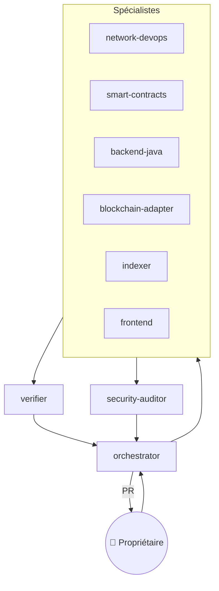
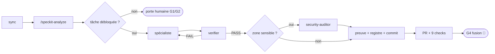

# Agentic Factory

## Agents (`.claude/agents/`)

| Agent | Périmètre | Preuve exigée |
|---|---|---|
| orchestrator | specs, schemas, registre, délégation | tâches cochées + registre |
| network-devops | infra/, scripts/, compose, .github | `sandbox.sh check` |
| smart-contracts | contracts/ | forge test + couverture + Slither |
| backend-java | backend/ | `mvnw verify` (Testcontainers) |
| blockchain-adapter | adapter/ | vitest + scénario e2e |
| indexer | indexer/ | indexé = balanceOf |
| frontend | frontend/ | tests unitaires + Playwright |
| verifier | evidence/, tests/e2e | rapport PASS/FAIL ré-exécuté |
| security-auditor | lecture seule | revue skill `security-audit` |

Les périmètres sont aujourd'hui une **convention** (prose des agents) ; leur application par le hook est prévue (spec 008, #31).

## Skills
- Spec Kit : `speckit-specify / plan / tasks / analyze / implement / converge / clarify / checklist / constitution`
- `security-audit` (Cloudflare, vendorisé, MIT) · `smart-contract-security` · `factory-run`

## Cycle `/factory-run NNN`

Les portes humaines sont détaillées dans [[Validations-humaines]].

## Garde-fous
- Hook `PreToolUse` (`.claude/hooks/guard.mjs`, 25 cas testés) : bloque lecture de `.env`/clés, introspection de conteneurs, `/proc/*/environ`, force-push simple, push vers `main`, `--no-verify`, contournement de la protection de branche. **Défense en profondeur, pas une frontière** : l'audit 008 a montré 22 contournements possibles sur une infra réelle (push `+main`, `kubectl`, `helm`, `terraform`, `ssh`, `vault`, `glab`…) → durcissement #31 avant toute cible Talan.
- `main` protégée côté serveur : PR obligatoire, 9 checks requis, admins inclus.
- Code cible exécuté via `scripts/sandbox-exec.sh` : copie `git archive`, `--network none`, FS lecture seule, limites.

## Ce que la factory a appris en exécutant
- Revue M-4 : références globales → squatting possible → références scopées par émetteur.
- E2E : couper `chain` ne coupait pas Besu (Besu aussi sur `signing`).
- E2E : Ponder peut indexer avant que l'adaptateur ne redémarre → règlement sur preuve on-chain (D-14).
- Échantillonneur d'invariant : Ponder revenait à un checkpoint antérieur après crash → `reorgWindow: 0` + watermark (D-23, P-15/P-16).
- Campagnes : deux échecs dus au **harnais** (limite `eth_getLogs` 5000 blocs, `pipefail`) documentés comme tels (P-19, P-20), pas cachés.
