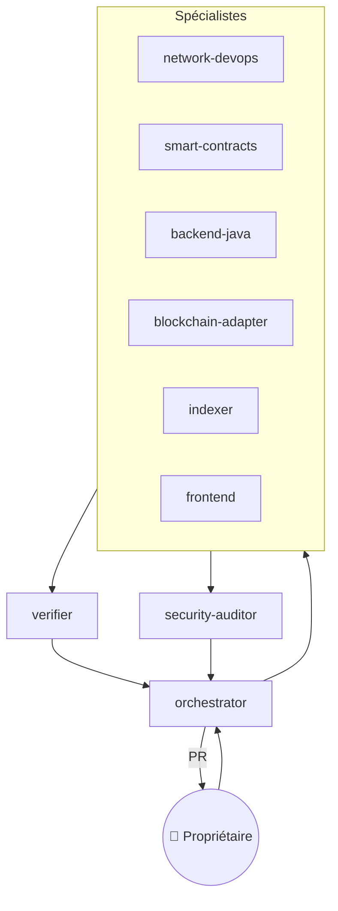
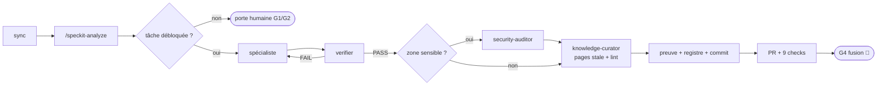

# Agentic Factory

## Agents (`.claude/agents/`)

| Agent | Périmètre | Preuve exigée |
|---|---|---|
| orchestrator | specs, schemas, registre, délégation | tâches cochées + registre |
| network-devops | infra/, scripts/, compose, .github | `sandbox.sh check` |
| smart-contracts | contracts/ | forge test + couverture + Slither |
| backend-java | backend/ | `mvnw verify` (Testcontainers) |
| blockchain-adapter | adapter/ | vitest + scénario e2e |
| indexer | indexer/ | indexé = balanceOf |
| frontend | frontend/ | tests unitaires + Playwright |
| verifier | evidence/, tests/e2e | rapport PASS/FAIL ré-exécuté |
| security-auditor | lecture seule | revue skill `security-audit` |
| knowledge-curator | docs/wiki, docs/knowledge, tests/knowledge (**imposé** par `.claude/hooks/knowledge-curator-guard.mjs`) | `knowledge-lint` sans erreur |

Les périmètres d'écriture sont **imposés** pour tous les agents. `knowledge-curator` a son hook propre, plus strict (`.claude/hooks/knowledge-curator-guard.mjs`, liste exacte de commandes). Les 9 autres agents sont couverts par `.claude/hooks/perimeter-guard.mjs <agent>`, déclaré dans le frontmatter de chaque agent et alimenté par `factory/perimeters.json` (33 cas testés, exécutés en CI : `.github/workflows/ci.yml`) ; c'est la décision D-26 (spec 008, lot L1, `specs/008-talan-readiness/tasks.md` T006). Le lot est livré en PR, pas encore fusionné. Les périmètres du tableau ci-dessus restent ceux de la prose des agents ; la liste imposée fait foi dans `factory/perimeters.json` (ex. `security-auditor` n'écrit que dans `docs/audit/` et le sous-dossier `security` d'`evidence` (pas encore créé), `verifier` dans `evidence/` et `tests/e2e/`).

## Skills
- Spec Kit : `speckit-specify / plan / tasks / analyze / implement / converge / clarify / checklist / constitution`
- `security-audit` (Cloudflare, vendorisé, MIT) · `smart-contract-security` · `factory-run`

## Cycle `/factory-run NNN`

Avant le commit, l'étape 7 de `.claude/skills/factory-run/SKILL.md` fait recompiler par `knowledge-curator` les pages rendues périmées par le changement, pour qu'explications et code soient revus ensemble ([[Base-de-connaissances]]). Les portes humaines sont détaillées dans [[Validations-humaines]].

## Garde-fous
- Hook `PreToolUse` **v2** (`.claude/hooks/guard.mjs`, 157 cas testés dans `.claude/hooks/guard.test.mjs`, dont les 22 contournements de l'audit 008 §A1) :
  - **Profil de cible** : variable `FACTORY_TARGET` → `factory/targets/<nom>.json` (`sandbox`, `talan-dev`, `talan-staging`) ; défaut `sandbox` ; profil inconnu ou illisible = tout refusé (infra, shell distant, reset, déploiement, diffusion).
  - **Modèle de risque** : chaque action est lecture, écriture ou destructive ; destructif = toujours refusé ; lecture/écriture suivent le profil ; décisions `allow` / `ask` (porte humaine) / `deny`.
  - **Familles couvertes** : `.env` lu par tout processus, dump d'environnement, clé privée en ligne de commande, Vault, secrets/variables forge, force-push sous toutes ses formes, approbation de PR interdite, merge = `ask` (G4), protection de branche/rulesets interdits, pipe vers un shell ou `eval`, `kubectl`/`helm`/`terraform`/`aws` destructifs refusés, `ssh`, signature/diffusion selon les hôtes du profil, WebFetch vers hôtes internes refusé, champ `glob` de Grep contrôlé.
  - `.claude/agents/verifier.md` : réinitialisation de la sandbox seulement quand la cible est `sandbox`. `.claude/settings.json` : deny `.env` élargi, `gh pr`/`gh issue` réduits aux verbes utiles, `deploy-contracts.sh` plus auto-autorisé.
  - **Durcissements v2.1 (revue sécurité de la PR #41, F1–F14)** : toutes les occurrences d'outils d'infra d'une commande sont contrôlées ; diffusion sans URL explicite = décision `broadcast` du profil ; lecture de secrets d'infrastructure (`kubectl … secret`, Secrets Manager, SSM) refusée ; fusion / approbation / réécriture de refs **via l'API** refusées ; en CI ou sur cible réelle, aucun agent ne peut modifier les fichiers de règles (`.claude/`, `factory/targets/`, `factory/perimeters.json`, `factory/human-gates.yaml`, `CLAUDE.md`) ; en mode bypass sur cible réelle, une demande de validation devient un refus (personne pour valider) ; entrée illisible = refus ; le texte libre (`-m`, `--body`) n'est plus analysé sauf substitution de commande.
  - **Défense en profondeur, pas une frontière** : règles par expressions régulières sur le texte des commandes. Les valeurs réelles des profils Talan restent à fournir (#37, `factory/targets/talan-staging.json` contient des `[NEEDS CLARIFICATION]`). Le lot est livré en PR (#31), pas encore fusionné.
- `main` protégée côté serveur : PR obligatoire, 9 checks requis, admins inclus.
- Code cible exécuté via `scripts/sandbox-exec.sh` : copie `git archive`, `--network none`, FS lecture seule, limites.

## Ce que la factory a appris en exécutant
- Revue M-4 : références globales → squatting possible → références scopées par émetteur.
- E2E : couper `chain` ne coupait pas Besu (Besu aussi sur `signing`).
- E2E : Ponder peut indexer avant que l'adaptateur ne redémarre → règlement sur preuve on-chain (D-14).
- Échantillonneur d'invariant : Ponder revenait à un checkpoint antérieur après crash → `reorgWindow: 0` + watermark (D-23, P-15/P-16).
- Campagnes : deux échecs dus au **harnais** (limite `eth_getLogs` 5000 blocs, `pipefail`) documentés comme tels (P-19, P-20), pas cachés.
