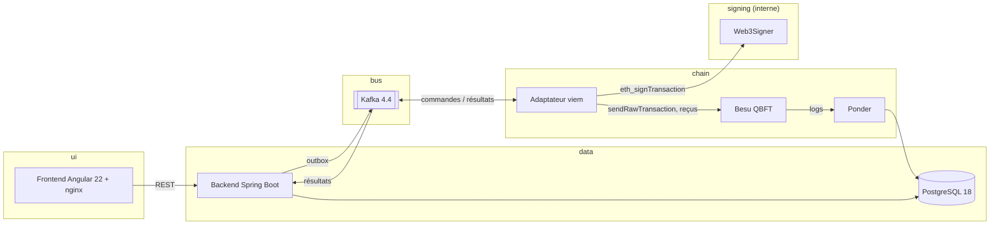
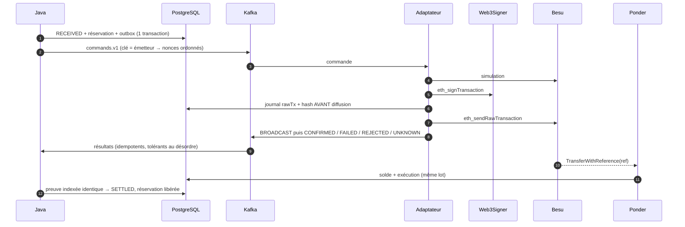
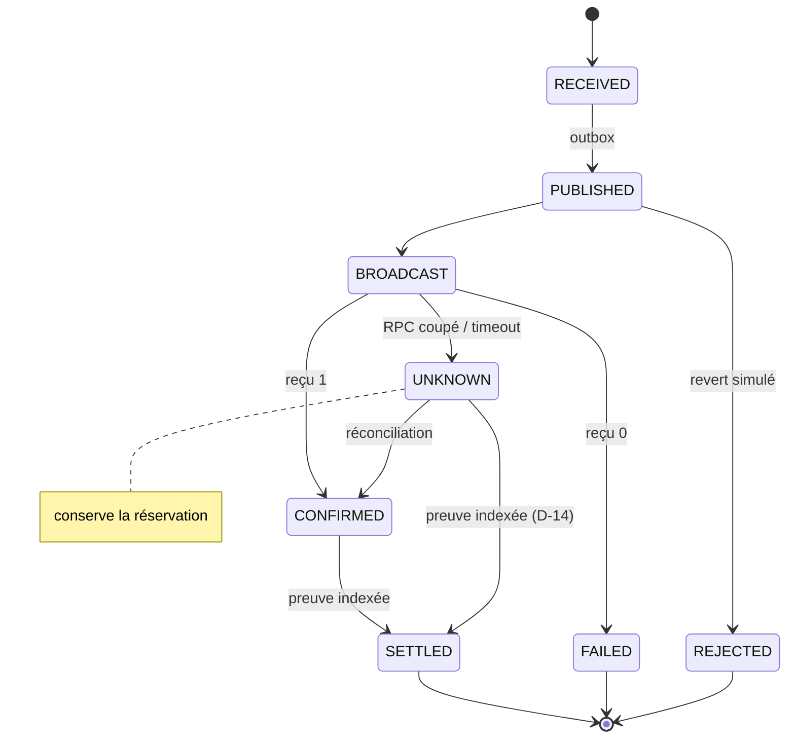

# Architecture

```
Écriture : Angular ─► Java (Spring Boot 4.1, Java 25) ─► Kafka 4.4 ─► Adaptateur (Node 24 + viem) ─► Web3Signer 26.10 ─► Besu 26.11 (QBFT)
Lecture  : Besu ─► Ponder 0.18 ─► PostgreSQL 18 (vues tela_read) ─► Java ─► Angular
```

## Composants et réseaux


| Réseau | Membres |
|---|---|
| `chain` | besu, adapter, indexer |
| `signing` (internal) | web3signer, besu, adapter, déployeur ponctuel |
| `data` | postgres, backend, indexer, adapter |
| `bus` | kafka, backend, adapter |
| `ui` | frontend, backend |

Ports hôte (127.0.0.1 uniquement) : UI 4200, API 8080, Besu 8545 (`ETH,NET,WEB3`), PostgreSQL 5432. Web3Signer et Kafka ne sont pas publiés.

## Séquence d'un transfert


## États d'une opération

Le règlement (D-14) se fait sur **preuve indexée** depuis n'importe quel état non terminal : des étapes intermédiaires peuvent être sautées si l'indexeur est plus rapide que les résultats Kafka.

## Garanties d'effet unique (Constitution §IV)
| Couche | Mécanisme |
|---|---|
| HTTP | Idempotency-Key (rejouée → même opération ; corps différent → 409) |
| Base | `disponible = indexé − réservations non indexées`, lu dans **un seul snapshot SQL** (D-21) |
| Kafka → adaptateur | journal `tx_attempt` : jamais deux signatures pour un operationId |
| Chaîne | `transferWithReference` : référence `keccak256(operationId)` consommable une fois **par émetteur** |
| Lecture | `SETTLED` uniquement sur événement indexé avec `to`/`amount` identiques ; garde de watermark + `reorgWindow: 0` (D-23) |
