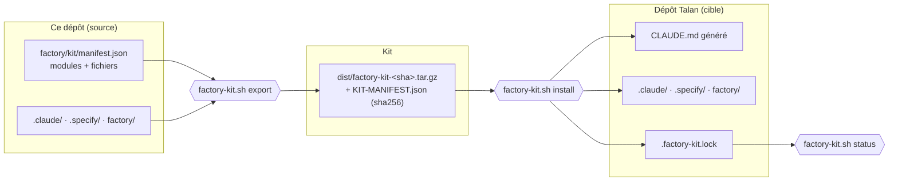

# Factory kit — réutiliser la factory sur un dépôt Talan

La factory est séparée en **modules** décrits dans [`factory/kit/manifest.json`](factory/kit/manifest.json). La commande `scripts/factory-kit.sh` les extrait de ce dépôt et les installe dans n'importe quel autre dépôt (GitLab Talan, autre projet), avec un fichier de verrou pour suivre les mises à jour.



| Module | Contenu | Portable aujourd'hui ? |
|---|---|---|
| `core` | Spec Kit (`.specify/`, skills `speckit-*`), orchestrator, verifier, security-auditor, skill `security-audit` (Cloudflare), hook `guard.mjs` + tests, portes humaines, `factory-run` | ✅ oui en local ; ⚠️ pas pour agir sur une infra réelle avant #31 (G8), `gh` codé en dur avant #32 |
| `blockchain` | agents smart-contracts, blockchain-adapter, indexer ; skill `smart-contract-security` | ✅ oui (contenu orienté EVM/Besu/Web3Signer) |
| `stack-tela` | agents backend-java, frontend, network-devops | ⚠️ contiennent les chemins de ce monorepo : à relire |
| `governance` | constitution TELA, modèle de registre F/H/D/P | ✅ comme point de départ |

```bash
scripts/factory-kit.sh list                                    # modules et fichiers
scripts/factory-kit.sh export --modules core,blockchain        # → dist/factory-kit-<sha>.tar.gz
scripts/factory-kit.sh install ../talan-repo --modules core,blockchain --project "TELA Talan" --dry-run
scripts/factory-kit.sh install ../talan-repo --modules core,blockchain --project "TELA Talan"
scripts/factory-kit.sh status ../talan-repo                    # fichiers modifiés localement / en retard sur la source
```
Règles du kit : **jamais** de fichier existant écrasé sans `--force` ; aucun secret, `.env`, preuve ou code applicatif n'est copié ; chaque fichier est listé avec son sha256 dans `.factory-kit.lock`. Une fois installé dans le dépôt cible, lancer Claude Code dans ce dépôt et commencer par `/speckit-constitution` puis `/speckit-specify`.

Voir aussi [[Validations-humaines]] et [[Talan-Readiness]].
