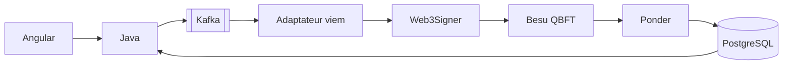

# TELA Agentic Factory — Wiki

Reproduction de l'infrastructure **TELA** (Talan) par une factory d'agents Claude Code spécialisés, en Spec-Driven Development (GitHub Spec Kit 1.3.2), avec **preuve d'exécution** pour chaque tâche et sécurité par défaut (skill Cloudflare `security-audit`).

> Source de vérité : le dépôt. Ce wiki est synchronisé depuis `docs/wiki/` par `scripts/publish-wiki.sh`. Les diagrammes sont en Mermaid (rendus par GitHub).

## Pages
| Page | Contenu |
|---|---|
| [[Architecture]] | composants, séquence d'un transfert, états, réseaux, effet unique (UML) |
| [[Agentic-Factory]] | agents, skills, hooks, cycle `/factory-run` |
| [[Validations-humaines]] | **où et comment un humain valide** (portes G1–G9), tableau GitHub |
| [[Runbook-Sandbox]] | démarrer, tester à la main, rejouer, diagnostiquer |
| [[Scenarios-et-preuves]] | les 4 tests exigés, campagnes SC-001…SC-004, preuves |
| [[Securite]] | contrôles, revues, suivis |
| [[Talan-Readiness]] | audit et plan pour passer sur l'infra Talan (spec 008) |

## État (2026-11-09)
| Spec | Statut | Suivi |
|---|---|---|
| 000 Agentic factory | ✅ livrée | — |
| 001 Sandbox + jetons | ✅ fusionnée | #16 |
| 002 Transfert TCE E2E + incidents | ✅ **validée** : SC-001 40/40, SC-002 119 crashs / 0 double débit, SC-003 p95 2,22 s, SC-004 1000 req. / min brut 0 | #18, #25, #30 |
| 003 Swap TCE→TCD | 🟡 décisions D-18…D-20 prises, à planifier | #9 |
| 004 TIF | ⛔ bloquée (sources TELA) | #10, #13 |
| 005 UI opérateur | ✅ fusionnée ; audit axe en suivi | #28, #29 |
| 006 Authentification API | 📌 réservée | #12 |
| 007 Gouvernance des expériences | 🔎 en revue | #24 |
| 008 Talan readiness | 🚧 audit fait, lots L1–L6 | #38, #31–#37 |
