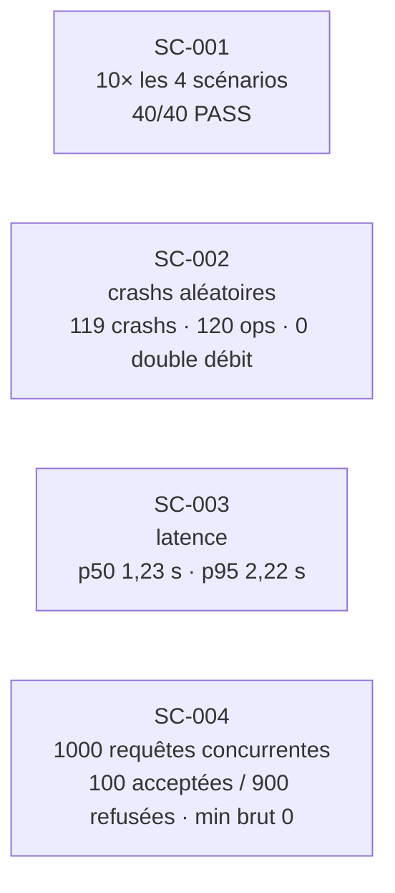

# Les quatre tests exigés et les campagnes

## Scénarios
| # | Test | Scénario | Résultat observé | Preuve |
|---|---|---|---|---|
| 1 | Transfert nominal | `nominal` | `RECEIVED>PUBLISHED>BROADCAST>CONFIRMED>SETTLED`, 1 débit, indexé = balanceOf | `evidence/002/nominal/` |
| 2 | Redémarrage après émission | `restart-after-broadcast` | crash réel après diffusion : 1 signature, 1 débit, 1 événement | `evidence/002/restart-after-broadcast/` |
| 3 | Retard de Ponder + concurrence | `ponder-lag` | 20 demandes / 10 possibles → 10 acceptées, disponible jamais négatif | `evidence/002/ponder-lag/` |
| 4 | Échec certain vs résultat inconnu | `failure-vs-unknown` | revert miné → `FAILED` ; revert simulé → `REJECTED` ; Besu coupé → `UNKNOWN` (conserve) ; **tx acceptée puis résultat perdu** → `UNKNOWN` → `SETTLED` sans 2e signature | `evidence/002/failure-vs-unknown/` |

Complément on-chain (001) : `transferWithReference` rejoué → `ReferenceAlreadyUsed`, aucun second débit.

## Campagnes de validation (spec 002, commit `7d4a02d`)

| Critère | Cible | Observé | Script |
|---|---|---|---|
| SC-001 | 10 répétitions déterministes | 40/40 | `tests/e2e/campaigns/sc001-*.sh` |
| SC-002 | 100 crashs aléatoires, 0 double effet | 119 crashs, 0 double débit | `sc002-*.sh` |
| SC-003 | p95 < 10 s | 2,22 s (latences individuelles archivées) | `sc003-latency.sh` |
| SC-004 | jamais de sur-réservation | 1000 req., 100/900, disponible brut min 0 sur 103 snapshots | `sc004-concurrency.sh` |

Périmètre : sandbox documentée (1 validateur, blocs de 2 s), exécutions locales (`ci: null`). Matrice complète : `specs/002-tce-transfer-e2e/validation-matrix.md`.

## Traçabilité
Chaque exécution écrit `evidence/<spec>/<scénario>/runs/<RUN_ID>/run.json` (SHA, état git, config, digests d'images) et `evidence.json`. Registre : P-01 … P-22 dans `docs/registry/REGISTRE.md`.
