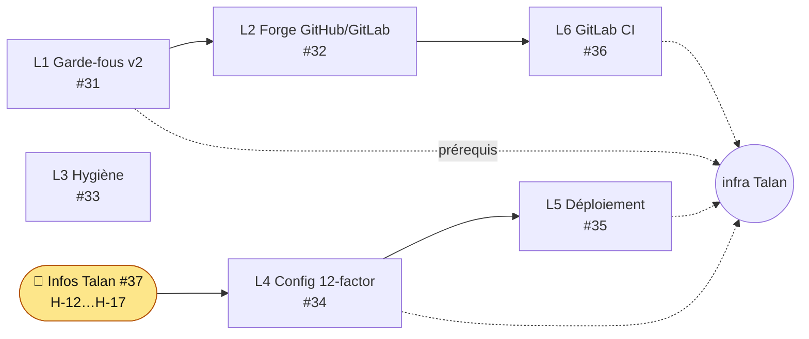

# Talan readiness (spec 008)

Objectif : sortir la factory et la stack de la sandbox pour travailler sur l'infra Talan (GitLab, nœuds Besu, key store, Kafka/PostgreSQL managés). Audit complet : `docs/audit/2026-11-09-talan-readiness.md` (PR #38).

## Verdict de l'audit (main @ 8530a55)
| Axe | Verdict |
|---|---|
| Garde-fous factory | ❌ 22 commandes dangereuses « infra réelle » non bloquées (constat de l'audit sur `main @ 8530a55` ; traité par L1, voir Avancement) |
| Portabilité forge | ❌ `gh` codé en dur (orchestrateur, factory-run, settings, hook, CI) |
| Stack runtime | ❌ gas nul / tx legacy, pas de TLS/SASL, pas d'auth API, nginx lié à Docker, pas d'artefact de déploiement |
| Hygiène | ⚠️ pas de bloat (61 Mo = sous-modules) ; preuves éparpillées, CI sans cache ni lint |

## Avancement
- **L1 Garde-fous v2 (#31) : livré, en revue** — T001 à T006 cochées (`specs/008-talan-readiness/tasks.md`) ; hook v2 à profils de cible, 157 cas testés dont les 22 contournements, périmètres d'agents imposés (`factory/perimeters.json`) ; décision D-26. Détail dans [[Agentic-Factory]] ; porte G8 dans [[Validations-humaines]]. Les valeurs des profils Talan dépendent encore de #37.
- L2 à L6 : tâches non cochées (`specs/008-talan-readiness/tasks.md`), inchangées.

## Plan

## Inconnues à fournir (#37)
| ID | Question |
|---|---|
| H-12 | GitLab : hébergement, version, runners, registry |
| H-13 | Besu : finalité, base fee / min gas, permissioning, TLS/JWT |
| H-14 | Contrats TELA réels : adresses, bloc de déploiement, référence d'opération |
| H-15 | Web3Signer : Vault / HSM / KMS, mTLS |
| H-16 | Déploiement : Kubernetes+Helm ou VM+Compose, gestion des secrets |
| H-17 | Kafka / PostgreSQL managés : SASL, TLS, droits DDL |
