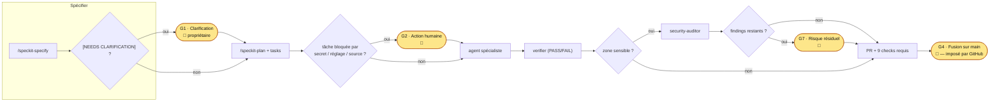
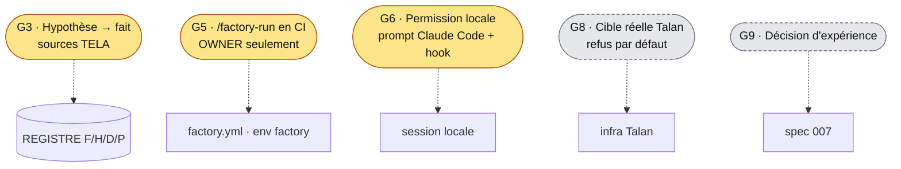

# Validations humaines

La factory avance seule **entre** les portes. À chaque porte, elle s'arrête et attend une décision du propriétaire. Cette page explique quand, pourquoi, comment valider, et **ce qui l'impose réellement** (serveur GitHub, hook local, ou simple convention).

| Interface | Pour qui | Accès |
|---|---|---|
| Tableau GitHub *TELA — Validations humaines* | humains | onglet **Projects** du dépôt (projet n° 2), grouper par « Porte » |
| `factory/human-gates.yaml` | agents, CI, outils (`yq`, scripts) | définition des portes G1–G9 |
| `scripts/human-gates.sh` / `--json` | terminal, agents | état courant (issues, PR, checks) via `gh` |
| `gh project item-list 2 --owner m4tth1euNa0p1c --format json` | outils | contenu du tableau |
| Formulaire d'issue « Validation humaine » | humains, agents | crée une carte avec sa porte |

## Où l'humain intervient dans le cycle


Portes transverses :


## Les portes

| Porte | Déclencheur | Comment valider | Imposé par | Preuve |
|---|---|---|---|---|
| **G1** Clarification | `[NEEDS CLARIFICATION]` dans une spec | répondre dans l'issue ; l'orchestrateur encode (D-xx) | convention, label `needs-clarification` | D-xx au registre |
| **G2** Action humaine | secret, réglage, source externe | faire l'action, fermer l'issue `[HUMAN]` | convention, label `human-action` | issue fermée |
| **G3** Hypothèse → fait | H-xx du registre | fournir la source | constitution | F-xx sourcé |
| **G4** Fusion sur `main` | toute PR | relire preuves + revue sécu, fusionner | **serveur** : PR obligatoire, 9 checks, admins inclus, pas de force-push | PR fusionnée |
| **G5** Factory en CI | commentaire `/factory-run NNN` | être OWNER | **serveur** : environnement `factory` limité à `main` | run Actions |
| **G6** Permission locale | commande hors allowlist | accepter/refuser le prompt | Claude Code + hook `guard.mjs` | `guard.test.mjs` |
| **G7** Risque résiduel | finding non corrigé | fusionner en connaissance de cause | convention, issue de suivi | commentaire de revue |
| **G8** Cible réelle | endpoint hors sandbox | choisir le profil `FACTORY_TARGET` | **prévu** (#31) | tests de contournement |
| **G9** Décision d'expérience | fin d'expérience | valider la décision bornée | **prévu** (#24) | fiche d'expérience |

## Ce que les portes ne garantissent pas (honnêtement)
- **G4** : aucune approbation de relecteur n'est exigée (dépôt mono-propriétaire). Si le propriétaire autorise un agent à fusionner dans la session, une PR verte peut être fusionnée sans relecture humaine ligne à ligne.
- **G6** : en mode *bypass permissions*, seules les règles du hook s'appliquent ; l'audit de la spec 008 a montré qu'elles ne couvrent pas une infra réelle (kubectl, helm, terraform, ssh, vault, `glab`…). D'où G8.
- **G1, G2, G3, G7** sont des conventions : un agent qui les ignore n'est pas bloqué techniquement, mais la constitution et le verifier le signalent.

## Validations attendues aujourd'hui
Voir le tableau GitHub ou :
```bash
scripts/human-gates.sh
```
